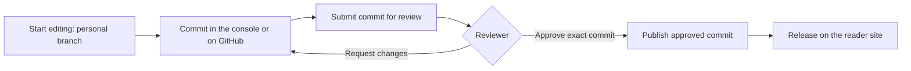

# How DocsAI works

A change in DocsAI always takes the same path: a branch, a commit, a review of that exact commit, and a release built from it.

## The pieces

| Piece | What it is |
|---|---|
| Tenant | Your organization in DocsAI. It has its own teams, projects and reader site address. |
| Project | One documentation repository opened in the console. |
| Repository | A GitHub repository with `catalog.json` at its root. It is the source of truth. |
| Branch | Where you change things. **Start editing** creates `work/<you>/<topic>` from the published base. |
| Review | A decision on one exact commit. A later commit needs a new review. |
| Release | An immutable build of an approved commit. The reader site shows the newest release. |

## Who does what

1. An **author** starts a branch, writes, and commits. Committing never publishes.
2. The author chooses **Submit commit for review**.
3. A **reviewer** reads the diff and chooses **Approve exact commit** or **Request commit changes**.
4. A **publisher** (a tenant admin, or anyone with the publish permission) chooses **Publish approved commit to current guides**. A background build produces the release.
5. **Readers** see the new release on the reader site. Drafts, pages in review and protected pages are never part of it.

## The console and GitHub stay in step

The console keeps its own copy of your repository. Two buttons connect it to GitHub:

- **Sync source** fetches the default branch from GitHub, so commits made on GitHub reach the console.
- **Push & open PR** pushes your console branch to GitHub and opens a pull request.

Publishing in DocsAI and merging on GitHub are separate actions. See [Work with pull requests](/docs/docsai/v1/pull-requests/) and [Sync changes from GitHub](/docs/docsai/v1/sync-changes-from-github/).

## Next steps

<Cards>
<Card title="Admin quickstart" href="/docs/docsai/v1/admin-quickstart/" description="Set up the repository and the reader site." />
<Card title="Author quickstart" href="/docs/docsai/v1/author-quickstart/" description="Take one change from a branch to readers." />
</Cards>
